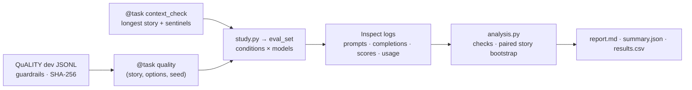

# QuALITY Contamination Probe

An Inspect AI task and a small analysis script that measure how much of a model's QuALITY score survives without the story, and whether what survives depends on the original answer letters or the original answer options. Inspect handles model access, retries, concurrency, logging and resume. This repo adds the dataset, the conditions, the scorer and the paired analysis.

## Goals

- **One question.** How much of a model's QuALITY dev accuracy depends on reading the story, and when it doesn't, what it depends on instead.
- **Built on Inspect AI.** No custom backends, retry logic, run directories or resume code.
- **Model-agnostic.** Any model Inspect supports, hosted or local. Default: `anthropic/claude-haiku-5-5`.
- **Honest numbers.** Paired comparisons, story-clustered intervals, errors never scored, non-answers counted, truncated contexts caught.
- **Reproducible.** Every reported number is recomputed from Inspect logs with no API calls, and scorer fixes are applied to existing logs with `inspect score`.

## Architecture



```text
quality_probe/
  dataset.py   # loader, guardrails, shuffle, swap
  prompts.py   # with-story and no-story system prompts
  scorer.py    # quality_scorer(): parse, status, map back to the original option
  task.py      # @task quality(...) and @task context_check(...)
  fakes.py     # oracle / always-A / random stand-ins (tests only)
study.py       # context check, then eval_set over conditions × models
analysis.py    # checks, metrics, paired story bootstrap, report
tests/
```

## Conditions

A condition is one set of `@task` arguments. All arguments are plain Python types, so `eval_set` can tell conditions apart and resume each one.

```python
@task
def quality(
    story: bool = True,
    options: str = "original",   # "original" | "shuffled" | "swapped"
    seed: int = 0,
    abstain: bool = False,       # adds "I don't know" as a final option
    fake: str | None = None,     # "oracle" | "always_a" | "random" (tests only)
    data: str = "data/QuALITY.v1.0.1.htmlstripped.dev",
) -> Task: ...
```

Default study matrix:

| Condition | Story | Options | Isolates |
|---|---|---|---|
| `full` | yes | original | The reading score |
| `no_story` | no | original | How much of the score survives without the story |
| `no_story_shuffled` | no | shuffled | Reliance on memorized answer letters |
| `no_story_swapped` | no | swapped | Reliance on the original option set |
| `full_shuffled` | yes | shuffled | Control: shuffling alone shouldn't move a reading score |

- **Shuffled.** Each question gets its own permutation from `Random(f"{seed}:{question_unique_id}")`, so it doesn't depend on sample order or `--limit`. The permutation is stored in sample metadata, and the target letter follows the gold option.
- **Swapped.** The three wrong options are replaced by wrong options from other questions about the same article, chosen with the same per-question seed. A candidate is skipped if it normalizes (casefold, collapse whitespace and punctuation) to the gold text or to another chosen option. The gold keeps its original letter, so this probe is independent of shuffling. Every borrowed option is stored with its source question ID and exported for review.
- Every model gets the same seed, so every model sees identical permutations and swaps.

## Data

- Source: `nyu-mll/quality` → `data/v1.0.1/QuALITY.v1.0.1.htmlstripped.dev` (JSONL). 230 entries, 115 articles (each appears twice with different question sets), 2,086 questions, 1,065 hard.
- `gold_label` is 1–4 (1 = A). Rows outside {1, 2, 3, 4} are skipped and logged, never scored. `difficult == 1` marks the hard subset; any other value counts as easy. `question_unique_id` is unique, and duplicates abort the load.
- A file without `gold_label` (the test split) aborts the load before any model call. The file's SHA-256 is recorded in task metadata.
- **Leakage rule.** Prompts are built only from the article, question and options. `gold_label` becomes `Sample.target` and nothing else. `writer_label` and the validation fields are dropped at load.
- Each question becomes one `Sample`: `id = question_unique_id`, `input = question`, `choices = options` (plus "I don't know" when `abstain` is set), `target = letter`, and metadata `article_id`, `difficult`, `story` (with-story conditions only), `perm` and `borrowed` (when present). Explicit IDs let Inspect reuse completed samples when a task is retried.
- Samples are ordered by `article_id`, so an article's questions run together and share a warm prompt cache.
- Development runs use `--limit` (the first N questions in article order). Reported numbers never do, and limited runs are marked `[partial]`.

## Prompts

The story goes in the system message and the question in the user message, so every question about an article shares an identical prefix. Inspect enables Anthropic prompt caching by default and places a cache breakpoint on the system message. Cache reads and writes are logged per sample. Caching is a cost optimization and never gates a run.

With story:

```text
[system] You are answering a reading comprehension question about the story below.

         <story>
         {story}
         </story>
```

Without story:

```text
[system] You are answering a multiple-choice question about a story that has been
         withheld on purpose. Answer anyway with your best guess.
```

User message (both): Inspect's `multiple_choice()` default template, which lists the lettered options and asks for a final line of the form `ANSWER: $LETTER`.

## Scoring

`quality_scorer()` parses the completion itself, so the rule belongs to this repo and is unit-tested.

- **Parse.** Take the last line of `output.completion` that consists only of `ANSWER: <letter>`, allowing any case, markdown emphasis, parentheses and a trailing period. Reference regex: `(?im)^\W*answer\W*:\W*([a-e])\W*$`, and the letter must be one of the offered letters. `ANSWER: A careful reading…` does not parse. Inspect separates reasoning (reasoning fields and `<think>` tags) from the completion, so reasoning text is never parsed.
- **Status.** Each sample gets exactly one status:
  - `ok`: a valid letter was parsed.
  - `parse_fail`: no valid line.
  - `abstain`: the model chose "I don't know".
  - `refused`: `stop_reason == "content_filter"`.
  - `truncated_output`: `stop_reason == "max_tokens"` with no valid line.
- **Value.** A sample is correct if the chosen letter maps through `perm` to the gold option. Every status other than `ok` counts as incorrect for accuracy, and each status rate is reported separately.
- **Metadata per sample.** Status, chosen letter, chosen original option, whether the choice landed on the gold's original letter (shuffled conditions), stop reason, and total prompt tokens (input + cache read + cache write).
- **Errors are never scored.** Tasks run with `retry_on_error=3` and the default `fail_on_error`. `eval_set` retries failed tasks and reuses completed samples. `analysis.py` refuses any log whose status isn't `success` or that contains an errored sample.
- **In-log metrics.** `accuracy()`, `grouped(accuracy(), "difficult")` and `stderr(cluster="article_id")` give quick feedback in `inspect view`. Reported numbers come from `analysis.py`.
- **Re-scoring.** A parser change is applied to existing logs with `inspect score --action overwrite`, with no new API calls.

## Analysis

`python analysis.py <log-dir>` reads the logs with `samples_df()` into one long table (model, condition, question ID, article ID, difficult, correct, status, prompt tokens). It writes `results.csv`, `summary.json` and `report.md`.

**Checks.** Any failure stops the report:

1. Every log has status `success` and no errored samples.
2. Conditions being compared have identical question ID sets. Pairing is always by question ID, never by order.
3. Every model has a passing `context_check` log in the same directory.

Any condition whose non-answer rate (`parse_fail` + `refused` + `truncated_output`) exceeds 2% is flagged in the report but still reported.

**Per model and condition:** questions, accuracy, hard accuracy, each status rate, and answered-only accuracy. SAT-style scores (+1 / −1/3 / 0) appear only when `abstain` is on. Without abstention, SAT = (4·acc − 1)/3 and adds nothing.

**Paired comparisons** (each a difference on the same questions):

| Comparison | Definition | Reading |
|---|---|---|
| Contamination gap | `full − no_story` | How much of the score needs the story |
| Letter probe | `no_story − no_story_shuffled` | How much of the no-story score rides on memorized letters |
| Option probe | `no_story − no_story_swapped` | How much rides on the original option set |
| Shuffle control | `full − full_shuffled` | Should be ≈ 0; if not, position bias muddies the letter probe |

The report also gives the share of `no_story_shuffled` answers that land on the gold's original letter, next to the model's overall letter distribution in that condition.

**Intervals.** All intervals use a story-level paired bootstrap:
- Resample the 115 articles with replacement (B = 10,000, fixed seed).
- Recompute every metric and every difference on the same resample.
- Report the 2.5th and 97.5th percentiles.

Questions about one story are correlated, so resampling questions individually would understate the uncertainty.

**Report format** (placeholders):

```text
claude-haiku-5-5 · QuALITY dev · 2,086 q · 115 stories
  full                acc 0.__ [_, _]   hard 0.__ [_, _]
  no_story            acc 0.__ [_, _]   hard 0.__ [_, _]   non-answer _._%
  no_story_shuffled   acc 0.__ [_, _]
  no_story_swapped    acc 0.__ [_, _]
  full_shuffled       acc 0.__ [_, _]
  gap (full − no_story)                +0.__ [_, _]
  letter probe (no_story − shuffled)   +0.__ [_, _]
  option probe (no_story − swapped)    +0.__ [_, _]
  shuffle control (full − shuffled)    +0.__ [_, _]
```

## What each number does and does not show

This section is generated into every `report.md`.

- **Gap.** Shows how much of the score needs the story. A small gap is consistent with contamination but isn't proof, because above-chance no-story accuracy can also come from eliminating implausible options.
- **Letter probe.** A drop under shuffling means no-story success leaned on memorized letters. Read it next to the shuffle control.
- **Option probe.** A drop under swapping means no-story success leaned on the original options, either memorized items or cues among them. Borrowed options can be partly true for the new question, so review the export before trusting a drop.
- **Limit.** None of these detect memorization of the story text itself.

## Models and servers

- **Providers.** Any Inspect provider works: `anthropic/…`, `openai/…`, `ollama/…`, `vllm/…`, or `openai-api/<provider>/<model>` for other OpenAI-compatible hosts. Each provider reads its own key variable (`<PROVIDER>_API_KEY` and `<PROVIDER>_BASE_URL` for `openai-api`), so no key is sent to the wrong host.
- **Sampling.** Temperature is 0 where the provider accepts it. Inspect's Anthropic provider sends no sampling parameters because the API rejects them. Whatever was sent is recorded in each log.
- **Output length.** `max_tokens` is set explicitly: 512 by default, with larger per-model overrides in `study.py` for reasoning models. Hitting the limit without an answer line is recorded as `truncated_output`, not as a silent wrong answer.
- **Reasoning models.** Inspect separates reasoning from the completion. On vLLM, pass the model's parser (`-M reasoning_parser=…`).
- **Local context.** Every story must fit in the context window.
  - Ollama's OpenAI-compatible endpoint ignores per-request context settings, so start the server with `OLLAMA_CONTEXT_LENGTH=16384`.
  - On vLLM, use `-M max_model_len=16384`. vLLM rejects prompts that don't fit rather than truncating them.
- **Context check.** Before running a model's study, `study.py` runs a one-sample task built from the longest article and its longest question. Sentinel words are placed at the very start and very end of the story, and the model is asked to repeat both. A missing sentinel means the server cut the prompt, and the study stops for that model. The check works regardless of tokenizer or how the server reports token usage.

## Running

```bash
pip install inspect-ai anthropic openai

# One condition, smoke-sized
inspect eval quality_probe/task.py@quality -T story=false \
  --model anthropic/claude-haiku-5-5 --limit 20

# Context check plus the full matrix for several models.
# Re-run the same command to resume.
python study.py --models anthropic/claude-haiku-5-5,openai/gpt-6-luna,ollama/llama3.1 \
  --log-dir logs/study-1

# Report from logs only (no network)
python analysis.py logs/study-1

# Browse every prompt, completion and score
inspect view --log-dir logs/study-1
```

`study.py` builds the five condition tasks from the same `@task` function and calls `eval_set(tasks, model=models, log_dir=…, retry_on_error=3)`.

## Cost

Haiku 5.5 bills $0.10 per million input tokens for prompts up to 100K tokens. Output is a few tokens per question.

| Run | Input tokens | Haiku 5.5 |
|---|---|---|
| One with-story condition | ~12.8M | ~$1.28 uncached, ~$0.25 with full cache reuse |
| One no-story condition | ~0.2M | ~$0.02 |
| Five-condition matrix | ~26M | ~$0.60–$2.70 |

Sonnet 5.5's input rate is $2 per million, 20× Haiku's, so each of its with-story conditions costs about $26 uncached. Cache reuse is what keeps the cross-model study cheap. Rates change, but every log records per-sample token usage, so actual cost is computed after the fact.

## Tests

All tests run offline with no API keys.

- **Loader.**
  - Counts match: 230 entries, 115 articles, 2,086 questions, 1,065 hard.
  - SHA-256 is recorded.
  - Duplicate IDs and the test split abort the load.
  - Invalid gold labels are skipped and logged.
  - No gold, writer or validation field can reach a prompt.
- **Shuffle.**
  - The same seed gives the same permutation regardless of order or `--limit`.
  - The target follows the gold option.
  - The permutation is stored.
- **Swap.**
  - The gold is never removed or duplicated.
  - Borrowed options come from the same article and a different question.
  - There are no normalized duplicates.
  - Every borrow is recorded.
- **Scorer.** At least 30 messy completions return the expected status. Cases include the article "a", "e.g.", echoed options, `ANSWER: A careful…`, markdown, empty output and a `max_tokens` cut-off.
- **Analysis.**
  - Synthetic results with known accuracies give exact metrics.
  - A coverage simulation of the bootstrap lands near 95%.
  - Mismatched ID sets, errored logs and a missing context check each stop the report.
- **End to end with fakes.** All five conditions run under `--model mockllm/model` with `-T fake=oracle|always_a|random`. The fake swaps the model call inside `multiple_choice()` for a deterministic stand-in, so prompt formatting, scoring and analysis run unchanged.
  - The oracle scores 100% in every condition.
  - Always-A matches each condition's share of gold = A.
  - Random lands near 25%.
  - `analysis.py` produces a report from those logs.

## Phases

### Build (offline)

1. **Data and conditions.** Loader, guardrails, shuffle, swap, and their tests.
2. **Task and scorer.** Prompts, `quality_scorer()`, fakes, and the end-to-end fake runs.
3. **Analysis.** Checks, metrics, paired bootstrap, report.
4. **Study runner.** `study.py` and the context check.

### Smoke (live, cheap)

- Run all five conditions at `--limit 20` on Haiku 5.5 and one local model.
- Confirm that:
  - logs open in `inspect view`;
  - cache reads appear on Haiku's with-story conditions (reported, not required);
  - non-answer rates are low;
  - the context check passes on a correctly configured local server and fails on one started with a context smaller than the longest story.
- Interrupt an eval set and re-run the same command. It should finish without regenerating completed samples.

### Study

The study starts only when every acceptance criterion below passes. The project is done when the study is done.

- **S1.** The five-condition matrix on Haiku 5.5 over the full dev set.
- **S2.** The same matrix on at least three models across two providers and two sizes (for example Haiku 5.5 and Sonnet 5.5, one OpenAI model and one local open-weight model), tabulated against release date and training cutoff where known.
- **S3.** `report.md` per model plus a combined write-up, with no claim stronger than the evidence.

## Acceptance criteria

Build and smoke are done when:

- All offline tests pass, including the end-to-end fake runs.
- Smoke runs complete on Anthropic and one local model, and `report.md` is generated.
- The context check fails a deliberately undersized local server, and `analysis.py` refuses to report without a passing check.
- A resumed eval set regenerates no completed sample.
- Changing the parser and running `inspect score --action overwrite` updates the report with no API calls.
- `analysis.py` runs with networking disabled.